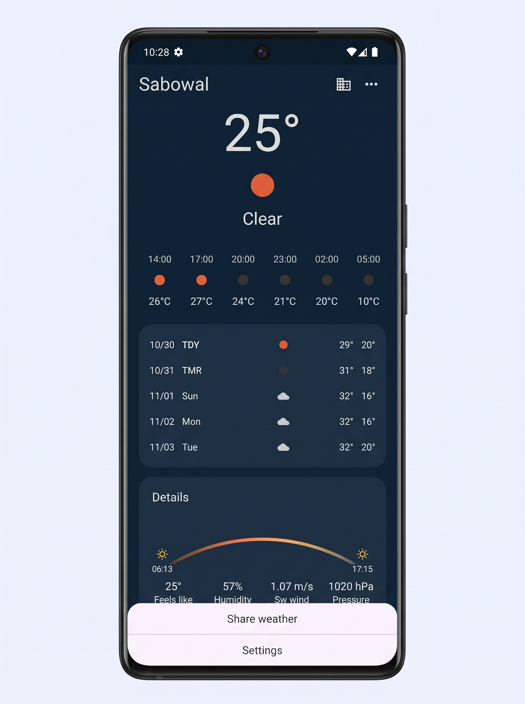
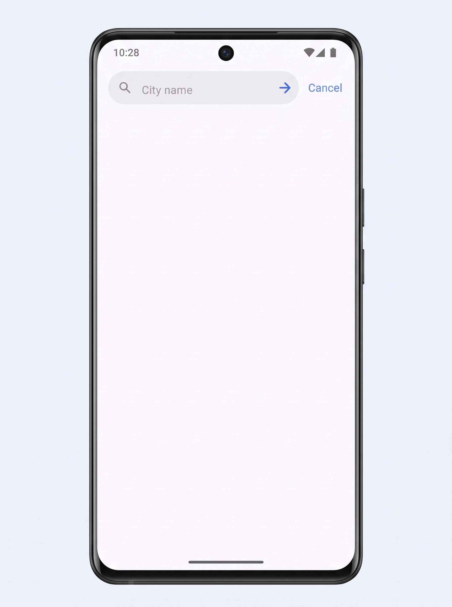
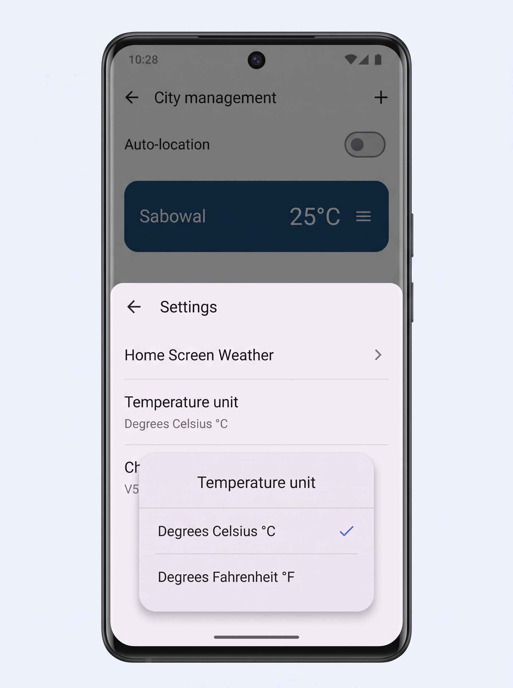
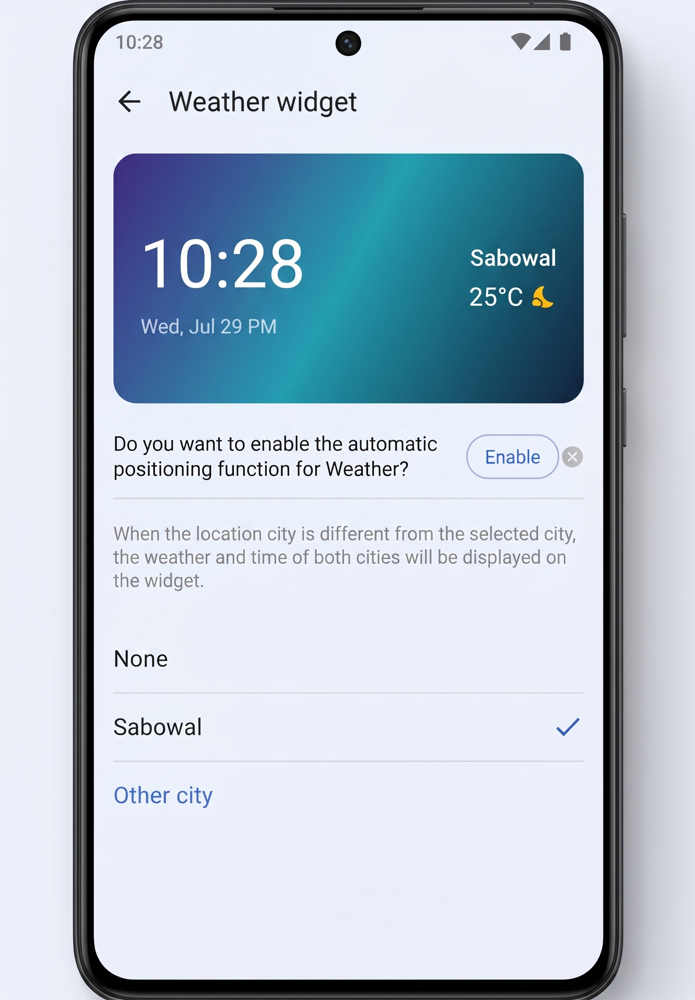

# Weather App 🌤️

A clean and reliable weather application built with Flutter that provides real-time atmospheric updates, hourly breakdowns, and multi-day forecasts using the OpenWeather API.

The project emphasizes clean architecture, practical state handling, background GPS location detection with web fallbacks, and persistent local storage so user settings remain intact across app launches.

---

## 📱 Screenshots

<p align="center">
  
  &nbsp;
  
  &nbsp;
  
  &nbsp;
  
</p>

---

##  Features

- **Live Weather Updates:** Current temperature, weather status, humidity, wind velocity, atmospheric pressure, and sunrise/sunset timings.
- **Smart GPS Tracking:** Automatic position detection using `geolocator` on mobile devices with graceful fallback support on web platforms.
- **Search & Manage Cities:** Find cities worldwide and organize a quick-access list of preferred locations.
- **Dynamic Unit Switching:** Seamlessly toggle between Celsius (°C) and Fahrenheit (°F) across all metrics without reload delays.
- **Forecast Tracking:** Hourly breakdown for the current day along with detailed upcoming weather trends.
- **Persistent Storage:** Keeps selected cities, location toggles, and measurement units saved locally via `shared_preferences`.

---

##  Architecture & Tech Stack

- **Framework:** Flutter (Dart)
- **State Management:** Provider
- **Design Pattern:** MVVM (Model-View-ViewModel) with a Repository layer
- **API & Networking:** OpenWeather API via standard `http` client
- **Location:** `geolocator`
- **Local Cache:** `shared_preferences`

---

## 📂 Project Structure

```text
lib/
├── models/         # Data parsing & JSON serialization models
├── providers/      # App business logic & UI state notifiers
├── repositories/   # Abstraction layer between API and business logic
├── screens/        # UI Views (Home, Search, Settings)
├── services/       # Network calls & device GPS interfaces
└── utils/          # App constants, helpers, and theme definitions